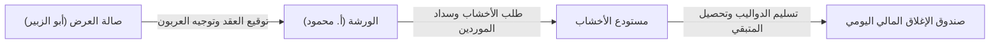
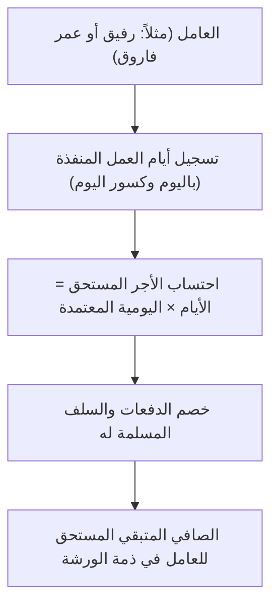

# المنهج التعليمي والدليل التشغيلي لمنظومة الأخشاب والدواليب

> **إعداد:** السكرتير أحمد  
> **الفئة المستهدفة:** أبو الزبير (الإدارة والمعرض) & الأستاذ محمود مصطفى (التشغيل والورشة)  
> **تاريخ الإصدار:** 2026-10-20 م  
> **رابط النظام المباشر:** [woodwork-erp](https://hosainnoor-hu.github.io/woodwork-erp/)

---

## 🧭 مقدمة وفلسفة المنظومة
صُممت هذه المنظومة خصيصاً لتلائم بيئة العمل الحقيقية في قطاع معارض ومناجر الأخشاب، والتخلص تماماً من شتات ملفات الإكسل الورقية واليدوية، عبر ربط صالة العرض مع ورشة التصنيع ومستودع الأخشاب في شاشة واحدة سريعة تعمل على الجوال واللابتوب حتى في حال انقطاع الإنترنت.

---

## 📚 الوحدة الأولى: أنماط التشغيل الأربعة (كيف تضبط واجهتك؟)

في أعلى الشاشة، يوجد خيار **«النمط»**، وهو مصمم ليمنح كل شخص ما يحتاجه فقط دون أي تشويش:

1. **النمط 1: الشامل المتكامل (`FULL`):**
   - يُظهر كافة الشاشات (معرض، ورشة، مستودع، حسابات). يُنصح به للإدارة العامة ولأبي الزبير والأستاذ محمود.
2. **النمط 2: المعرض وصالة المبيعات فقط (`SHOWROOM`):**
   - يُخفي تفاصيل الورشة والألواح الخام، ويُبقي فقط: (عقود التفصيل، الكروكي، الديون غير المسددة، ومصروفات المعرض). مخصص للبائعين (`محمد، عيسى، يونس`).
3. **النمط 3: ورشة التصنيع والقص فقط (`WORKSHOP`):**
   - يُخفي عقود البيع، ويُبقي: (محطات التصنيع الخمس، كشف عمال المياومة والسلف، ومصروفات الإعاشة والزيوت والصيانة). مخصص لمعلمي الورشة.
4. **النمط 4: مستودع وتجارة الأخشاب فقط (`WAREHOUSE`):**
   - مخصص لتجارة الألواح الخام والمبيعات المباشرة للمناجر الخارجية ومتابعة أرصدة الموردين (`زاهد، عواجي، أراك`).

---

## 📚 الوحدة الثانية: ميزان التسوية الشهرية لعام 2026 م (دفاتر أ. محمود)

هذه الشاشة تجيب بضغطة زر واحدة على السؤال الأهم: **«هل نحن كسبانين هذا الشهر؟ ولك أو عليك؟»**

### كيف تقرأ الجدول الشهري؟
- **الحوالات + شبكة:** جميع المبالغ النقدية والبنكية التي دخلت حساب المؤسسة.
- **فواتير المعارض:** إجمالي فواتير الدواليب المنفذة لمعارض (داريفا، ماي هوم، والألمنيوم).
- **مصاريف الورشة:** الإعاشة، السباكة، الصيانة، وتعبئة الخزانات.
- **الفرق (لك أو عليك):** 
  - باللون الأخضر `+`: يعني أن الحوالات تفوق الفواتير (فائض سيولة لك).
  - باللون الأحمر `-`: يعني أن الفواتير تفوق المحصل (مبالغ معلقة قيد التحصيل لصالحك).

---

## 📚 الوحدة الثالثة: إدارة حسابات ومطابقة موردي الأخشاب (زاهد وعواجي)

بدلاً من الدفاتر الورقية، تم تخصيص تبويب **«مطابقة موردي الأخشاب»** لمتابعة فواتير الألواح:

1. **اختيار المورد:** بالضغط على زر **«زاهد للأخشاب»** أو **«عواجي للأخشاب»**.
2. **كشف الطلبيات (الجانب الأيمن):**
   - يُظهر كل لوح تم طلبه بكوده (`AW-01`، `1135 أراك`، `1146 جوردن`) وكميته وسعره الفردي، مع تصنيف القسم (خشب أو ألمنيوم).
3. **كشف السداد والمردودات (الجانب الأيسر):**
   - يُظهر الحوالات البنكية ومدفوعات الشبكة.
   - **المردودات والترجيع:** أي لوح تم إرجاعه أو خصم شريط يظهر بلون كهرماني ويُخصم تلقائياً من رصيد المورد.
4. **بطاقة الرصيد المتبقي:** تُظهر الصافي المطلوب سداده بدقة سنتيمترية وريالية (`32,064` ر.س لزاهد).

---

## 📚 الوحدة الرابعة: كشف عمال المياومة الأسبوعية ونظام السلف

تم بناء هذا القسم ليتوافق تماماً مع طريقة الأستاذ محمود في تسجيل يوميات العمال:

- **خطوات صرف سلفة أو دفعة:**
  1. ادخل على تبويب **«كشف العمال والرواتب والسلف»**.
  2. تأكد من تفعيل زر **«عمال المياومة الأسبوعية»**.
  3. أمام اسم العامل، اضغط على زر **«صرف دفعة»** وسجل المبلغ، وسيُحدث النظام الصافي المتبقي له تلقائياً.

---

## 📚 الوحدة الخامسة: عقود التفصيل والكروكي والديون غير المسددة

### 1. توقيع عقد جديد مع العميل (أبو الزبير أو البائع):
1. اضغط على الزر الذهبي أعلى الشاشة **«+ عقد تفصيل»**.
2. أدخل بيانات العميل (الاسم، الجوال، البائع المسؤول).
3. أدخل طول الدولاب بالمتر وسعر المتر (يقوم النظام بحساب الإجمالي آلياً).
4. **توجيه العربون (فكرة أ. محمود الذكية):** 
   - حدد أين سيذهب العربون المقبوض؟ هل لصندوق المؤسسة أم سداد مباشر لفاتورة مورد خشب (`أخشاب طه، زاهد، أراك`)؟
5. حفظ وطباعة العقد فوراً متضمناً **وثيقة الضمان الذهبي لـ 5 سنوات** وجدول الدفعات وكود الزكاة والضريبة.

### 2. متابعة الديون غير المسددة (الآجل):
- ادخل على تبويب **«الديون غير المسددة (الآجل)»**.
- تظهر لك جميع العقود المعلقة بمبالغها المتبقية.
- عند استلام الدفعة الأخيرة عند التركيب، اضغط على زر **«تحصيل الآن»** وأدخل المبلغ المقبوض، لتدخل السيولة فوراً في صندوق اليوم وتُقفل الفاتورة.

---

## 📚 الوحدة السادسة: صندوق الإغلاق اليومي للسيولة والدرج

في نهاية كل يوم عمل، يجيب هذا الصندوق عن حركة السيولة الفعلية عبر المعادلة المحاسبية المعتمدة:
$$\text{المبيعات المحصلة} - (\text{مشتريات الموردين المسددة} + \text{المصروفات النقدية}) = \text{الصافي المتبقي بالدرج}$$

- لا مجال لاختلاط الحسابات؛ فمصاريف المعرض مفصولة عن إعاشة وصيانة الورشة، ومسحوبات المالك الشخصية مفصولة في مركز تكلفة مستقل.

---

## 💡 نصائح ذهبية للعمل المشترك بين أبي الزبير والأستاذ محمود:
1. **استخدام الجوال في الورشة:** يمكن للأستاذ محمود إضافة الصفحة إلى الشاشة الرئيسية لجواله لتفتح كأنها تطبيق هاتف مستقل (`PWA`).
2. **المزامنة السحابية:** إذا كنت متصلاً بالإنترنت ستجد المؤشر أخضر 🟢، وإذا انقطع الإنترنت بالورشة سيتحول لأصفر 🟡 ويستمر التطبيق في حفظ كل البيانات محلياً دون أي توقف أو فقدان للمعلومات.
